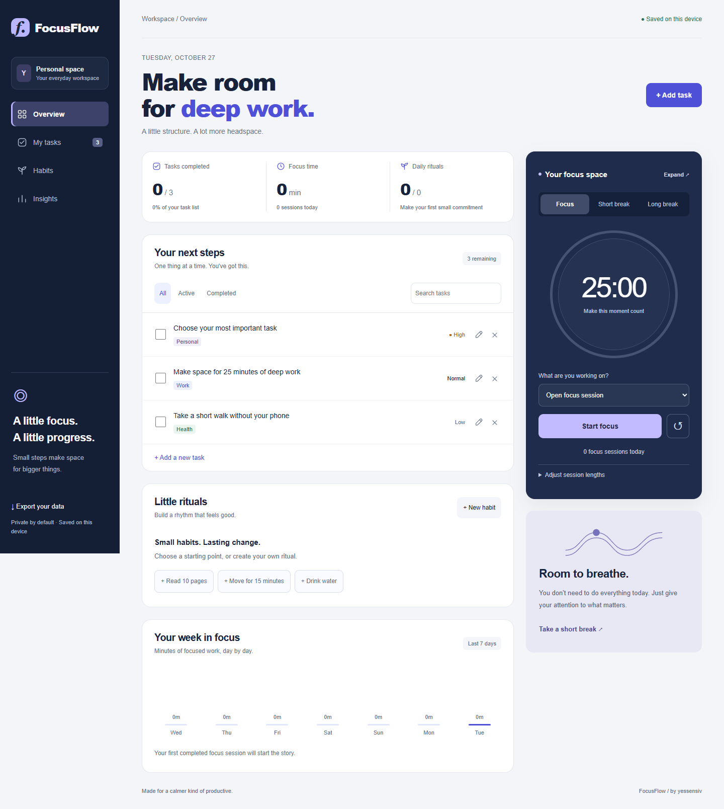

# FocusFlow

A calm, local-first workspace for tasks, daily habits and focused work. Built with vanilla JavaScript, CSS and native browser APIs. No account, build step or application dependencies.



## Features

- Create, edit, complete and delete tasks; filter by status and search by name.
- Organize tasks by area, priority and optional due date.
- Track habits over the last seven days with daily check-ins and streaks.
- Run focus, short-break and long-break timers with adjustable lengths.
- Expand the timer into a distraction-free focus view; return with Escape.
- Start a daily ritual with one click using optional habit suggestions.
- Pause, resume and restore timers after a reload. Elapsed time uses a timestamp, so a background tab does not slow the timer.
- See genuine completed-session history and weekly focus minutes.
- Export your data as JSON. Everything stays in this browser's local storage.
- Responsive layouts, keyboard controls, accessible dialogs and reduced-motion support.

The three initial tasks are editable onboarding suggestions. Habit check-ins and session statistics start empty; no activity is fabricated.

## Run

Requires Node.js 20 or newer.

```sh
npm start
```

Open http://127.0.0.1:4173. To use a different port, set the `PORT` environment variable. The bundled server is a local development server. For hosting, serve `index.html`, `app.js`, `model.js`, `style.css` and `icon.svg` with any static host.

```sh
npm test
```

## Data and limitations

Data belongs to the browser profile and origin you use. Clearing site data removes it. JSON export provides a backup; import and cross-device sync are not included. Use one active tab for editing: concurrent tabs are not synchronized. Font files are requested from Google Fonts; the app works with fallback fonts when they are unavailable. Notifications are shown inside the app; this is not a background alarm service.

## History

Six implementation milestones use author and committer dates October 16–21, 2026, as requested. The project was assembled and redesigned on October 27, 2026; the Git dates are retrospective milestones, not a claim of work performed on those days.

1. Workspace and visual system.
2. Task management and persistence.
3. Habits and streaks.
4. Pomodoro and completed sessions.
5. Insights and responsive layouts.
6. Validation, accessibility polish and documentation.

## License

MIT © 2026 yessensiv
