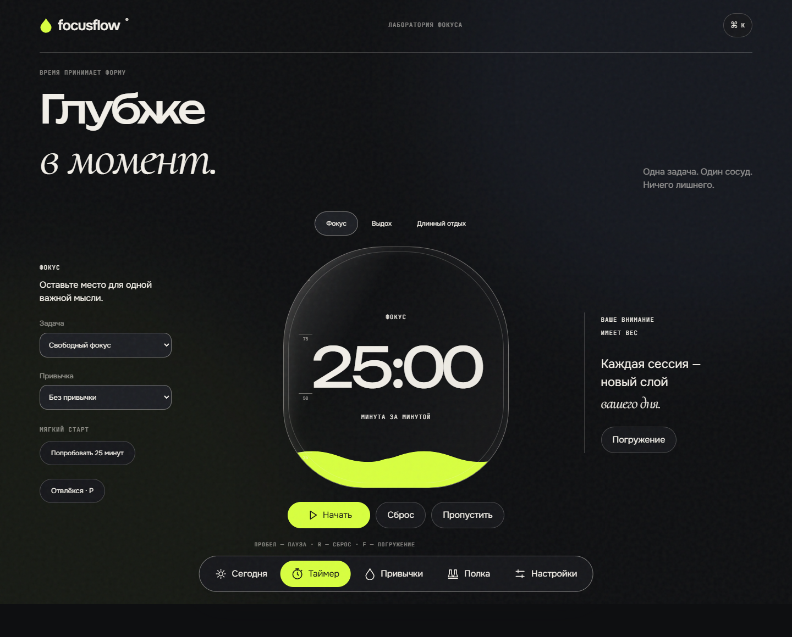
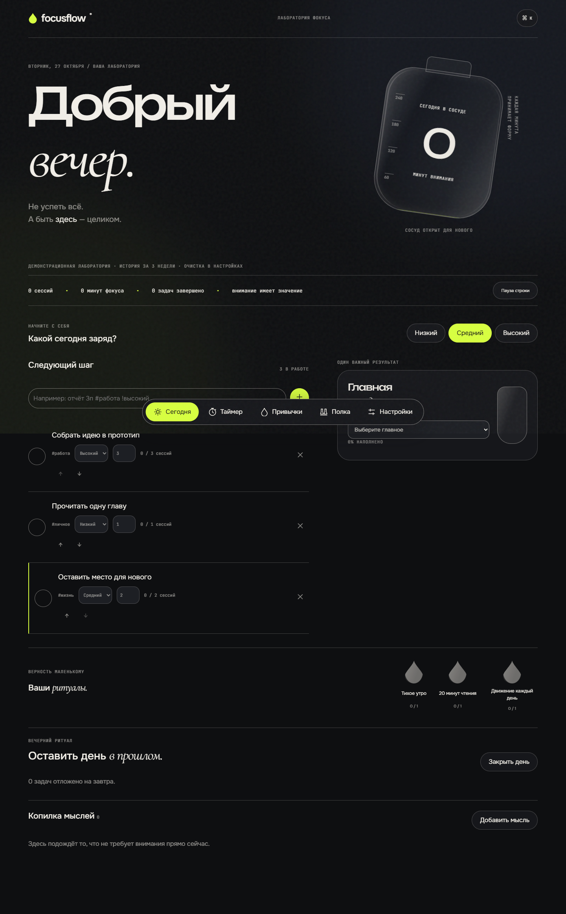
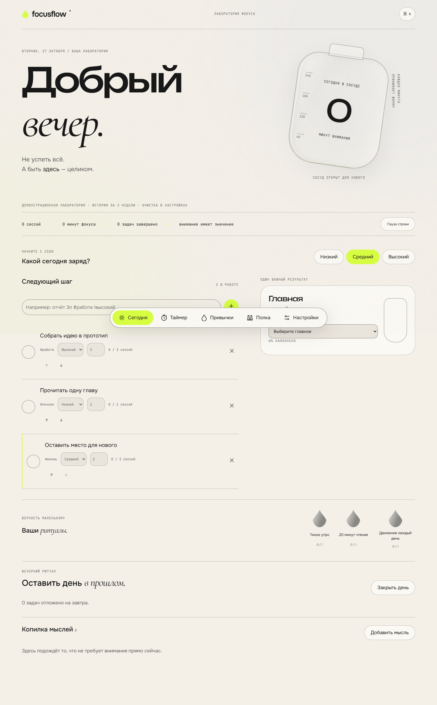
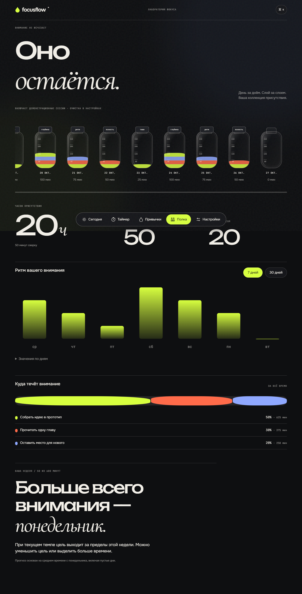

<div align="center">

# FocusFlow

### Внимание — по капле.

Не успеть всё. А быть здесь — целиком.<br>
Личная лаборатория для задач, привычек и глубокого фокуса.

**Pomodoro · Ежедневные ритуалы · Наглядная статистика**

[Возможности](#возможности) · [Посмотреть интерфейс](#интерфейс) · [Начать](#начать) · [Горячие клавиши](#горячие-клавиши)

</div>

<br>



## Время, которое можно увидеть

В FocusFlow время превращается в жидкость. Каждая завершённая сессия добавляет цветной слой в стеклянную колбу дня. Цвет связан с задачей или привычкой, а накопленные колбы остаются на вашей полке.

Выберите главное, наполните день вниманием и посмотрите, куда оно ушло.

## Возможности

| | Ваше пространство |
| :--- | :--- |
| **Сегодня** | Отметьте уровень энергии, выберите главную цель и найдите следующий посильный шаг. |
| **Фокус** | Запустите Pomodoro, наблюдайте за наполнением сосуда или включите погружение, чтобы убрать лишнее. |
| **Привычки** | Собирайте неделю из капель. Поддерживайте серии, связывайте привычки в цепочки и оставляйте место для маленького минимума. |
| **Полка дней** | Рассматривайте слои сессий, открывайте детали колб и отслеживайте свой ритм на графиках за 7 или 30 дней. |
| **Копилка мыслей** | Запишите то, что отвлекло, и возвращайтесь к делу. Разобрать мысли можно позже. |

### Один шаг — без лишних действий

Введите задачу одной строкой:

```text
Подготовить отчёт 3п #работа !высокий
```

FocusFlow распознает **3 сессии**, тег **«работа»** и **высокий приоритет**. Перед добавлением вы увидите, что получилось. Задачи можно переставлять, завершать и удалять.

### Глубже в момент

Перед стартом задайте намерение: **«Что должно получиться за эту сессию?»** Или просто начните.

Таймер поддерживает фокус, короткий и длинный отдых, паузу и продолжение после перезагрузки. Режим погружения оставляет только время, намерение и жидкость. После завершения можно оценить внимание каплями и отметить настроение.

Длительности настраиваются под вас. По высоким оценкам последних сессий приложение предложит попробовать более длинный фокус — решение остаётся вашим.

### Ритм, в котором есть место жизни

Не каждый день одинаковый. Если сил мало, выберите **«Сегодня — только минимум»**: капля наполнится наполовину, а серия сохранится. Один пропущенный день в неделю может стать заморозкой вместо обнуления прогресса.

Привяжите привычки друг к другу: после одного действия легче начать следующее. Завершённая сессия может одновременно продвинуть задачу и засчитать повторение привычки.

### Красиво закончить день

Перенесите незавершённое на завтра, разберите копилку и выберите одно слово о прошедшем дне. Оно останется на пробке вашей колбы.

## Интерфейс

Чернильная тема с кислотным лаймом для вечернего фокуса. Тёплая бумага — для светлого пространства. Стекло, волны и контрастная типографика связывают всё в одну лабораторию.

<details>
<summary><strong>Сегодня · чернильная тема</strong></summary>



</details>

<details>
<summary><strong>Сегодня · тёплая бумага</strong></summary>



</details>

<details>
<summary><strong>Полка · ваша коллекция внимания</strong></summary>



</details>

<details>
<summary><strong>Та же лаборатория — на маленьком экране</strong></summary>

<div align="center">

</div>

</details>

## Начать

1. Скачайте проект через **Code → Download ZIP** и распакуйте архив.
2. Откройте **index.html** двойным кликом в браузере.
3. Выберите задачу и запустите первую сессию.

Установка и регистрация не нужны. При первом запуске вас встретит подписанная демолаборатория. Для своего чистого пространства выберите **Настройки → Очистить все данные**.

## Горячие клавиши

| Клавиша | Действие |
| :--- | :--- |
| `Пробел` | Начать / приостановить таймер |
| `F` | Погружение |
| `Esc` | Выйти из погружения или закрыть окно |
| `P` | Припарковать мысль во время фокуса |
| `R` | Сбросить таймер с подтверждением |
| `Ctrl+K` / `Cmd+K` | Найти действие в командной палитре |

Буквенные команды работают в латинской раскладке и не мешают вводу текста. Все основные действия доступны с клавиатуры; уменьшенное движение учитывает настройки устройства.

## Ваше пространство — ваши данные

Задачи, привычки и сессии сохраняются в этом браузере. В настройках можно **экспортировать копию в JSON** и **восстановить её импортом**. Перед переносом папки или очисткой браузера сохраните копию; автоматической синхронизации между устройствами нет.

Для шрифтов нужен интернет. Само приложение работает локально; уведомления зависят от разрешений браузера. Если браузер закрыт, FocusFlow не заменяет системный будильник.

---

<div align="center">

**Маленькие ритуалы. Глубокое внимание. Ваш собственный ритм.**

Создано [yessensiv](https://github.com/yessensiv)

</div>
