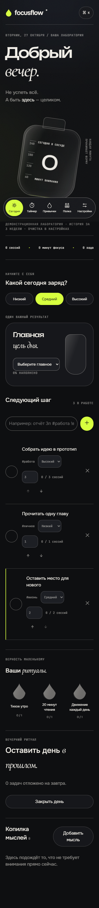

<div align="center">


# FocusFlow

### Make room for deep work.

A little structure. A lot more headspace.<br />
Your personal workspace for tasks, daily rituals and focused sessions.

**Vanilla JavaScript · Local-first · No account required**

[Explore the workspace](#the-workspace) · [Get started](#get-started) · [How it works](#your-daily-flow) · [View mobile design](#on-a-smaller-screen)

</div>

---


## The workspace

One place to choose your next step, protect your attention and see your progress.

| Plan your day | Find your focus | Build your rhythm |
| :--- | :--- | :--- |
| Create, edit and complete tasks | Focus, short-break and long-break timers | Daily habits with a seven-day check-in grid |
| Organize by area, priority and due date | Adjustable lengths, pause and resume | Streaks and optional one-click habit suggestions |
| Search and filter your task list | Expand the timer into a distraction-free view | Weekly focus minutes and completed-session history |

### Designed for a calmer kind of productive

- **A clear visual hierarchy.** Midnight navigation, a paper workspace and a prominent lavender-accented timer.
- **Your pace, your space.** Expand the focus view when you need fewer distractions; press `Escape` to return.
- **Pick up where you left off.** Tasks, habits and timer state persist in this browser. A timestamp keeps the running timer aligned with elapsed time.
- **Progress you actually made.** Statistics come from your check-ins and completed sessions. No invented scores or sample activity.
- **Keep a copy.** Export tasks, habits and sessions together as JSON.
- **Use the screen you have.** Responsive layouts, labelled controls, keyboard focus, native dialogs and reduced-motion support.

<a id="on-a-smaller-screen"></a>

<details>
<summary><strong>On a smaller screen</strong></summary>
<br />
<div align="center">

</div>
</details>

## Get started

Requires **Node.js 20 or newer**. There are no application dependencies to install and no build step.

```sh
git clone https://github.com/yessensiv/focusflow.git
cd focusflow
npm start
```

Open **http://127.0.0.1:4173** in your browser.

To choose another port, set the `PORT` environment variable before starting. The bundled server is intended for local development. For hosting, serve `index.html`, `app.js`, `model.js`, `style.css` and `icon.svg` with a static host.

## Your daily flow

1. **Choose one next step.** Add a task, select its area and set a priority.
2. **Give it your attention.** Select the task in the timer, choose a session length and start.
3. **Make room for a break.** After a focus session, the timer switches to a short break, ready for you to start.
4. **Build a small ritual.** Add a habit and mark the days you follow through.
5. **Look back gently.** Review your weekly focus time and export a backup when you need one.

The three initial tasks are editable onboarding suggestions. Habits, check-ins and session history start empty.

## Under the hood

| Part | Built with |
| :--- | :--- |
| Interface | Semantic HTML, CSS, inline SVG |
| Application | Vanilla JavaScript and native browser APIs |
| Persistence | Browser local storage |
| Local server | Node.js HTTP module |
| Tests | Node.js built-in test runner |

```sh
npm test
```

Tests cover date boundaries, task filters, habit streaks, timer pause/resume, weekly totals, malformed saved data and HTML escaping. Browser interaction checks and responsive verification are documented in [Validation](docs/validation.md). See [Design direction](DESIGN.md) for the visual decisions.

## Your data

Your workspace is stored in the **browser profile and origin** you use. There is no account or application backend.

- Clearing site data removes the saved workspace. JSON export gives you a backup; import is not included.
- Cross-device synchronization and coordination between open tabs are not implemented. Use one active editing tab.
- Google Fonts supplies the typefaces; fallback fonts keep the app usable when those requests are unavailable.
- Notifications appear inside the app. FocusFlow is not a background alarm service.

## Project history

The six implementation milestones use author and committer dates **October 16–21, 2026**. This README presentation is an additional commit dated **October 16, 2026**. The project was assembled and redesigned on October 27, 2026; these Git dates are retrospective milestones, not a claim of work performed on those days.

## License

[MIT](LICENSE) © 2026 [yessensiv](https://github.com/yessensiv)

---

<div align="center">
<strong>A little focus. A little progress.</strong><br />
Made for a calmer kind of productive.
</div>
